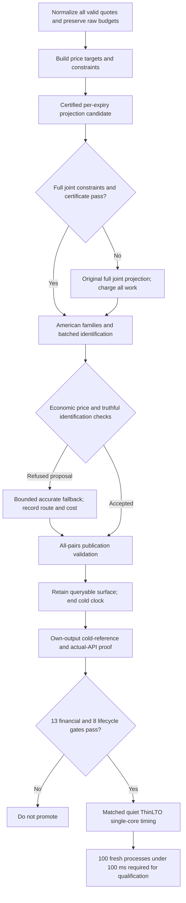

# Executing the single-core 100 ms SPY plan

The user designated the [100 ms guide](C:/atx/.superpowers/sdd/2026-10-18-vol-sota/2026-10-24-atx-vol-spy-cold-fit-100ms-plan.md)
as the new execution guide on 2026-10-24. Its SHA256 at adoption is
`2aada6138a8f095ff9d495394efc86ac58f8791fd9ac5e3ad253578b44b41396`.
This record supplies subsequent evidence and implementation decisions; it does
not overwrite the guide or historical receipts. Phase clocks in that guide are
planning estimates, not achieved latency or mathematical lower bounds.

## Contract and authorization

- Target: complete cold SPY fit below 100 ms on one core, with resident-input
  `retained_surface_publication_v1` timing. All required fitting, IV identification,
  validation and retained queryable publication remain inside that clock.
- Serve all 33 valid expiries and all 12,866 eligible rows; preserve at least
  99.5% containment and the actual-API arbitrage and identification requirements.
- Price consistency uses `min($0.001/share, 1% of the original raw spread)`.
  Strict `1e-7` IV comparisons remain diagnostics. No additional permission to
  demote identified quotes to PriceOnly is implied.
- The user's numerical-freedom instruction and adoption of A2 authorize a
  different certified feasible surface and a different optimization objective.
  The joint least-squares optimum and identical output hashes are not required.
- Empirically qualified interpolation is permitted as research under the
  existing explicit empirical contract, with each candidate's own cold-reference
  proof and declared domain. Sampled validation is not a uniform mathematical
  bound and does not qualify arbitrary future instruments or markets.
- A failing proposal must retain the original full solver/fallback, include its
  cost and publish its outcome honestly. The canonical fast candidate must
  eventually pass without that fallback. Two-worker timing cannot satisfy the
  single-core headline.

These decisions use existing user authorization. No owner response is pending.
Input/source/binary hashes still establish evidence integrity; they do not
prescribe numerical identity with an older fit.

## Corrections to the planning baseline

1. **A1 has completed and is unfavorable.** The first bounded working set passes
   its own 13 financial and 8 retained-instance checks, but performs 71 reduced
   factorizations followed by the original 35-factor full solve. It remains
   default OFF. The three reduced attempts leave 3,058, 1,455 and 396 omitted
   violations. Their worst published slacks are approximately -0.666, -0.367 and
   -0.155. A fourth round is not presumed sufficient. The reported 3.4171109 s
   cold clock had heavy host/sibling activity and is diagnostic only.
2. **Calendar violations are not rare or only adjacent.** The existing census
   has 6,467 initially violated rows: 3,332 convexity, 1,858 parity, 13 endpoint
   slope and 1,264 calendar. Of the calendar violations, 540 occur on 28 adjacent
   expiry pairs and 724 on 88 nonadjacent pairs. Zero bound rows are violated.
   The violated-calendar graph connects 32 expiries and contains a 24-edge
   directed path. Holding the initial earlier targets fixed makes 35 retained
   rows impossible even at future box extrema; this motivates look-ahead,
   without proving the data or a sequential solve infeasible.
   The saved feasible surface's 99.8834% containment is not evidence that the
   original target is jointly feasible. A2 must respect unequal strike domains
   and nonadjacent constraints; adjacency alone is not an admissible shortcut.
3. **The direct-price-seed clock was misattributed.** Exact r9 route counters give
   70 direct attempts, 61 roots and 26.5880 ms, with 123 boundary solves and zero
   IV iterations in that stage. The approximately 100.5 ms
   `reimply_seed_candidate_ns` counter belongs to the separate prepared cold-seed
   candidate tier. C1's claimed 95 ms saving cannot be used as an execution
   forecast. The scalar `price_candidate` stage is 163.5864 ms, with 700 calls,
   684 roots, 1,158 boundary solves and 1,437 IV iterations. Its shortest expiry
   alone costs 102.9473 ms. Economic family work is 128.0510 ms and batch lane
   work is 44.0585 ms. Prepared cold-seed work is 100.4090 ms, nested inside
   its 100.5059 ms candidate-owner clock; do not add those two. These counters
   are from `graded_stats.slices[*].timing` in the r9 native JSON, SHA
   `f93bfe13e6272c99654a8b1bea18a3569952326d2b3f495b0be0273104626686`.
   Choose the next identification change using the actual route work.
4. **The certificates have distinct sampling semantics.** Joint certification
   visits union knots; publication validation visits union knots and midpoints.
   D preserves each set, its allowance calculation and all-pairs traversal.
5. **The factor-work arithmetic is not a lower-bound proof.**
   `35 * 8,817,051 * 1.5 ns = 462.9 ms`, not 150 ms. Conversely, the cited
   201-209 ms factor totals imply about 0.651-0.677 ns per counted update pair.
   Counter meanings and measured clocks must be joined before extrapolation.
   Likewise, 1.323-1.447 s divided by 1.8284 s is 0.724-0.791, not 0.63.
   Separate replay clocks cannot be substituted for a matched whole-fit run.
6. **Family bounds and node extrapolations need qualification.** The existing
   `RefinementValidated` class is empirical. Its `1e-12` node/reference allowances
   are in transformed-boundary units; they are not a uniform `1e-11` USD price
   error. Halving the sigma grid does not establish a square-root price error.
   The public family header already records that the relative merit of sigma
   and log-sigma axes changes at eight nodes. B2 must measure its actual boxes,
   off-node points, floor behavior and all served rows.
7. **Some B4 work is already implemented.** Per-preparation time/grid coefficients
   and carry exponential reuse are present, with an archived preparation-only
   saving of 7.59/15.18/9.27 ms. Do not implement or count that saving twice.
   A deeper node-kernel profile remains useful; the earlier scalar-Fast builder
   comparison did not justify changing the production builder.

The first four corrections come from current source and saved native evidence,
not new performance trials. The census classification has frozen row-identity
and maturity joins. Its exact latest-expiry partition assigns every original
row once, producing 60-650 variables and 288-2,750 rows per block, with observed
index half-bandwidth at most four. These are promising structure counts, not
an executed sequential solve or latency measurement. Census receipt:
`C:/atx-cache/quote-benchmark/spy-qualified-r7-20261023/acceptance/sequential-projection-census-v1/final/receipt.json`,
SHA `fa6a7b410bd110ffe5d6866c41bac1b570d425122d58ab7fe67d6d7eb3dacf90`.

## Active work and decision gates

D has now passed its own complete SPY correctness audit at `cf2b0983`: all
13+8 gates, 33/33 valid expiries and 12,866/12,866 eligible rows. Both native
walks visit all 528 pairs. Diagnostic pair clocks are 2.5749 ms for joint
certification and 9.9017 ms for publication; the full fit is 1.7614329 s on a
busy host with the non-IPO build. See the [actual result](calendar-linear-walk-20261024.md).
This completes the component's whole-fit correctness gate. Quiet ThinLTO
comparison and the 100-process qualification remain outstanding.

| Lane | Immediate work | Evidence required before a whole-SPY candidate |
|---|---|---|
| Projection | Classify saved violations and binding rows; implement small expiry subproblems with earlier-expiry constraints and a full joint fallback | Exact row/domain semantics, infeasible greedy cases, transactional output, actual work counters, fresh source review |
| Identification | Private economic-policy family preparation for 1-3 day expiries; retain the public 3-day guard and the existing 16-node grid/probes | Refusal reasons, floor/low-vega behavior, raw-spread budgets, scoped regressions, explicit research switches |
| Calendar validation | Linear walk integrated and own-SPY correctness passed; preserve it in subsequent combined candidates | Qualified timing remains open; actual 528-pair counts are retained |
| Integration | Preserve negative outcomes, maintain default controls, join each changed candidate to its own proof | 13 financial + 8 lifecycle gates, source/binary/input receipt and one-core provenance |

Warm continuation of the unsuccessful working set is held while A2/A3 is
evaluated. Neither A2 feasibility nor a 30 ms projection time is established.
The guide's suggested 15 microseconds per small factorization is a hypothesis;
the actual per-slice sparsity and constraints decide whether a banded backend
is appropriate. A3 also needs a demonstrated feasible construction, not an
assumption that a backward box envelope resolves every coupled shape constraint.

The diagram is the proposed execution structure. It does not claim the
per-expiry candidate, shared-tenor families or sub-100 ms performance exists.

## Shared-tenor families: the mathematical and implementation boundary

For constant model parameters, the Andersen-Lake-Offengenden formulation uses
a boundary as a function of remaining maturity; this supports investigating
reuse over a shorter interval. Their time-dependent extension explicitly loses
that universal maturity boundary. Therefore B3 is appropriate to investigate
for the current per-expiry constant-carry model, with interpolation across
those constant parameters, rather than silently treating true term structures
or dated cash dividends as equivalent. See sections 2 and 7 of the
[original paper](https://engineering.nyu.edu/sites/default/files/2019-03/Carr-adjusting-exponential-levy-models.pdf).

Current `AlSigmaQFamily::State::price_on` prices at `grid.T`; the family owns
time nodes and a geometry-dependent quadrature workspace. A shorter maturity
needs a correctly keyed view with its own integration geometry and boundary
evaluation at the proper physical remaining times. Simply replacing T in a
stack copy would rescale the represented boundary incorrectly. New rate-axis
interpolation, carry-regime crossings and shorter-maturity interpolation error
must all be accounted for. Model invariance does not make two finite
collocation approximations numerically identical or equally accurate.

B2/B3 will be assessed against the economic contract, with no requirement for
identical IVs. Removing a probe because an envelope is assumed valid is not
justified when that same probe is part of the empirical envelope's validation.
Changing the probe set requires its own qualification and unchanged rejection
behavior for unqualified domains.

## Preserved research outside the immediate SPY path

The retained-policy PDE control finished once: 10 of 12 requests computed, with
both finest-space grids refusing at the fixed cap. Delta and Gamma remain
unresolved. The single-cash-event cubic builder is frozen and source reviewed;
its independent reference and six declared case outcomes are pending. Both
lanes retain their artifacts and may resume for the general American-equity
pricing/analytics objective. They are not counted as SPY speed improvements.

## Evidence pointers

- Correctness baseline: local main `05ccc878`; tested r9 numerical source
  `202db209`, archived own-output result under
  `C:/atx-cache/quote-benchmark/spy-qualified-r7-20261023/integrated-research-r9/`.
- Working-set candidate: `e000b9dd2e3b82189c64c1685a9ed33d5b25f5d1`,
  [independent outcome review](C:/atx-cache/quote-benchmark/spy-qualified-r7-20261023/acceptance/working-set-outcome-review-v1/outcome-and-continuation-proposal.md),
  review SHA `c68ac68a1df74311f4b947e7b7606f1d4db2dc885811df977854cac1966cfa7b`.
- Envelope semantics: [economic family candidates](reimply-economic-family-candidate.md)
  and [K3 construction](sigma-q-family-error-envelope.md).
- Existing preparation optimization: [geometry reuse](family-tensor-geometry-reuse.md)
  and [builder comparison](family-tensor-builder-experiment.md).
- Preserved PDE outcome: [fixed twelve controls](independent-lcp-retained-pde-result-20261024.md).

No qualified subsecond result or worldwide performance ranking is established
by this checkpoint. The 100 ms target remains active.
