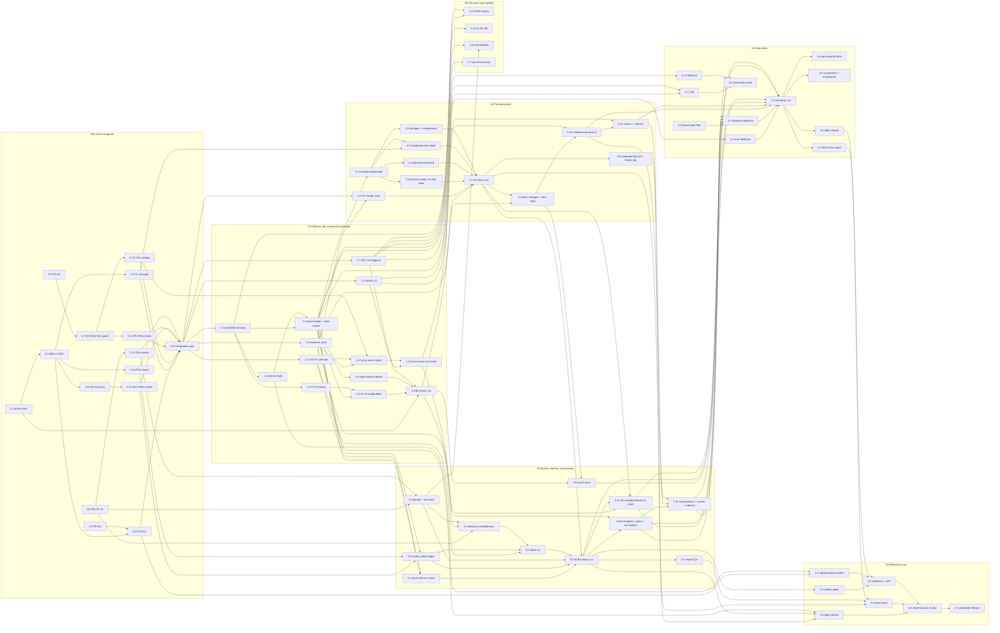

# atx-db Tier-1 v2 — DAG Sprint Series (index and spec)

> **For agentic workers:** REQUIRED SUB-SKILL: Use superpowers:subagent-driven-development to execute the sprint files
> task-by-task. This index is the **spec** every sprint file argues from; read §3 (constraints), §4 (memory doctrine)
> and §5 (swarm rules) before any task. Steps use checkbox (`- [ ]`) syntax. **User directive: no test-driven
> development.** Tasks are accepted on **real-data measurements**, not on new unit tests (see §5.4).

**Goal:** Take atx-db from "raw data plus fixture-proven code" to a materialized, point-in-time, survivorship-aware US
equity fundamentals warehouse whose main product is a large, statistically graded library of cross-sectional
characteristics with 1–12 month predictive evidence, shipped as a reproducible candidate release.

**Architecture:** Every heavy stage becomes a ledgered set of short, bounded (≤ 1.0 GiB) batches that a slice runner
admits through the existing memory guard, so no job ever needs a sustained memory window again. Research reads
immutable Parquet (a research lake plus a content-addressed per-feature store) instead of contending for the warehouse
writer, which lets real cross-sectional analysis start in Sprint 1 on the retained price bars while the fundamentals
ladder materializes. Evaluation follows Jensen–Kelly–Pedersen construction conventions and a pre-registered,
wave-based qualification policy (v4).

**Tech Stack:** Python 3 (`C:\atx\atx-db\.venv`), DuckDB 1.5.5, PyArrow/Parquet (zstd), existing atx-db modules
(`activation.py` ladder, `_bulk_publication.py`, `research/*` stats core with EWC fixed-b inference),
`run_memory_guarded.py` guard.

**Spec / evidence:** this index is the spec. It was synthesized on 2026-09-26 from the session-3 status file
(`docs/superpowers/handoffs/2026-09-25-tier1-parity-status-3.md`), the controller ledger
(`.superpowers/sdd/tier1-parity/claude-ctl/progress.md`), and five review reports kept in the session scratchpad
(`C:\Users\natha\AppData\Local\Temp\claude\c--atx\b4bd2aa4-4a8c-4961-a262-297640e82cb3\scratchpad\plan-*.md`:
`plan-digest.md`, `plan-review-data.md`, `plan-review-research.md`, `plan-review-pit.md`, `plan-web-research.md`).
Those reports are supporting detail only; every number a task needs is copied into its sprint file.

## Sprint files

| # | File | Theme | Lanes |
|---|---|---|---|
| S0 | `2026-09-25-tier1-v2-s0-land-integrate.md` | Land the killed swarm's WIP, clear review debt, integration gate | I, MIG, ACT, K, F, R, Q |
| S1 | `2026-09-25-tier1-v2-s1-bounded-platform-b0.md` | Bounded build platform, CompanyFacts/submissions completion (B0), research store, policy v4, first real price-signal results (nodes 1.1–1.13) | M, MIG, D, X, R |
| S2 | `2026-09-25-tier1-v2-s2-fundamentals.md` | Fundamentals materialization (B1), PIT reader fixes, standardization depth, vintages, fundamental characteristics | F, D, R |
| S3 | `2026-09-25-tier1-v2-s3-market-identity-survivorship.md` | Market/identity/survivorship/labels materialization (B2/B3), event features, final labels | K, D, R |
| S4 | `2026-09-25-tier1-v2-s4-cross-sectional-evaluation.md` | Full-family real evaluation, external validation, composites, ownership wave, alpha export, factor-zoo report, survivorship delta (nodes 4.1–4.8) | R |
| S5 | `2026-09-25-tier1-v2-s5-release-ops.md` | Quality gates, reproducible release, daily refresh, documentation, whole-branch review, candidate release | Q, OPS |
| SX | `2026-09-25-tier1-v2-sx-source-acquisition.md` | User-gated data acquisition (13F, FINRA, benchmarks, FSDS history, 8-K EX-99, strict identity, pre-2012 prices) | X |

Sprints are **waves**, not strict phases: the DAG in §6 is authoritative. Research tasks in S1 run concurrently with the
platform work in S1–S3.

---

## 1. Where the project stands (2026-09-26, HEAD `da28fb60`, branch `feat/tier1-parity`)

**Warehouse (`atx-db/data/warehouse.duckdb`, 12.0 GiB).** Raw data only:
- `sec_company_facts` / `fundamental_points`: 47,941,000 rows each for 9,462 lineage-verified CIKs. **9,558 of 20,390
  CompanyFacts archive members were never loaded.**
- `equity_daily_bars`: 31,959,271 rows, 34,251 ids / 25,760 vendor lines, 2012-03-26 → 2026-09-18.
- `sec_submissions`: 10,297,910 rows (resume lineage `04cf947d…` unfinished).
- `custom_features_daily` 31.9M rows; `exchange_listings` 45,820 rows with **zero** venue rows.
- **Zero rows** in `fundamental_standardized`, `derived_metric_values`, `market_daily_metrics`, `equity_price_metrics`,
  listing/universe/delisting/terminal tables and survivorship-safe forward returns. 375 of 379 quality checks never
  ran; all 12 provider SLO snapshots missing.
- Schema: the ledger says migrations 0001–0326 applied; one review cites 0322. **S0 task 0.1 settles it.** 0327 is
  registered but unapplied; 0328 is committed but **not registered** (registry head 327).
- Only backup: `warehouse.duckdb.pre-migrate.20260924-225023.bak` (12.0 GiB). C: has ~97 GB free.

**Retained source files.** `data/cache/companyfacts.zip` (20,390 members, 17.98 GiB JSON, max member 8.8 MB);
`data/cache/submissions.zip` (991,042 members, 5.35 GiB JSON); `data/staging/broad-bars/2026-09-20-updated/
TickerHistory3.parquet` (3.37 GiB, 32.05M rows, sha `0ed96b26…`); 8 FSDS quarters (`data/cache/P12-fsds/`, 818 MB);
FRED DTB3. **Not on disk:** 13F, FINRA short interest, 8-K EX-99 documents, pre-2012 prices, dated listing/venue history.

**Code.** 50+ commits this session. Research lane (panel, feature store, events, factors, composites, ownership,
qualification ledger with EWC inference) is sophisticated but **proven on fixtures only**. 12 committed tasks are
unreviewed or mid-fix (P5, R3d, P8, P9, P1, P13, R2d, P14, A8 follow-up, R1e, VA1, MIG0328) and 9 killed lanes left
WIP (S1, P8 fix1, P9 fix1, RI2 + P1 fix1, E1 + R2d fix1, P13 fix1, W2, currency_status, 0328 pin fix) — committed on
2026-09-26 as 11 unreviewed per-lane WIP commits `f9743583`…`36c8059f` (table in the S0 file).
Only 57 of 254 test files have ever run.

**Why nothing was materialized.** Structural, not bad luck. 3,571 watcher samples (busy host, 25–26 Sep): median free
physical 2.82 GiB, median free commit 3.76 GiB. The guard's own preflight (min(phys, commit) ≥ job_gb + 2) admits a
1.5 GiB job 21.7% of the time, 1.0 GiB 39.2%, 0.8 GiB 48.4%. The watcher's extra bar (3.6 phys / 6 commit for 120 s)
held 0 times in 186 windows. Only 29% of 3-minute windows stay above the kill floors. And the archive21 job itself is
quadratic: each attempt re-proves 96M rows (8 min) and replays 10,832 members (~26 min) before its first write, then
probes the full 48M-row table per new member (est. 13–27 h). **Long single-shot jobs cannot finish on this host.**

## 2. Definition of done — Tier-1 v2 exit criteria (all measured on real data)

| Area | Criterion | Measured by |
|---|---|---|
| Raw completeness | All 20,390 CompanyFacts members dispositioned (loaded / empty / unavailable, matching 1,327 empty and 43 unavailable); rebuilt facts digest-equal to live for the 9,462 verified CIKs; all 991,042 submissions members read, `scope_complete=true` | 1.8 |
| Fundamentals | `fundamental_standardized` and `derived_metric_values` populated; ≥ 90% of seeded derived definitions produce valid rows; FSDS stratified 10k-cell benchmark ≥ 95% mapped and ≥ 98% of mapped cells within 0.5%; A = L + E holds on ≥ 99% of issuer-periods; item gate (ITEM_COVERAGE: 110 annual items, top 3000, FY2015+) measured and published | 2.7, 2.8 |
| Vintages | `first_reported`, `as_of(D)` and restatement-event views served; revisions per firm-period reported | 2.6 |
| Identity | Operating-company attrition ≤ 12.0%; 0 preferred/warrant/unit lines linked as common; permanent security and company ids never recycled; dated link table with basis, tier and primary flag; names history for all 25,760 lines | 0.6, 3.3, 3.7 |
| Survivorship | Every cessation has a terminal return or a labeled exclusion; 0 Shumway imputations without performance evidence; dropped-anchor histogram published | 3.4, 3.5, 3.7 |
| Calendar/returns | XNYS session table reconciles to bars with 0 extra and 0 missing sessions; labels enter at next session; VA1 artifact neutralized everywhere | 1.11, 3.5, 3.7 |
| Feature library | ≥ 250 graded characteristics (175 existing catalog rows + ≥ 75 new: price/friction, fundamental batch A, scores, events, ownership) in the feature store, 2012-04 → 2026-08; coverage: core fundamentals ≥ 3,000 owners/month, price natives ≥ 4,500 lines/month, conditional features ≥ 60% of their population | 1.12, 2.10, 2.11, 3.9, 3.10, 3.11, 4.5 |
| Evaluation | For every characteristic: rank IC/ICIR, EW/VW/capped-VW decile and tercile L/S, investable-slice IC, Fama–MacBeth, Jegadeesh–Titman K ∈ {1,3,6,12}, IC decay, turnover and break-even cost, FF6 alpha; qualification ledger under policy v4; external validation gate passed (atx Mkt vs French Mkt-RF ρ ≥ 0.99, SMB/UMD ≥ 0.90, HML ≥ 0.85, RMW/CMA ≥ 0.75) | 4.1–4.3 |
| Alpha delivery | JKP-layout monthly Parquet panel + characteristic metadata + theme factor returns, ≤ 1 GB, loads < 30 s at < 800 MB | 4.6 |
| Release | Candidate release reproducible (two publishes from one snapshot byte-identical apart from `created_at`; replay reproduces every Parquet sha256); 379/379 DQC and 12/12 SLO snapshots recorded; DATA_DICTIONARY and API snapshot current; methodology + coverage + known-issues docs | 5.1–5.7 |
| Operations | Every heavy stage resumable after a kill with 0 duplicate keys; daily SEC incremental cycle runs 5 times unattended | 1.3, 5.3 |

**Honest ceiling.** Without strict dated identity evidence (user gate U5 / RX13) the release status is `candidate`,
never `eligible`: the strict `us_listed_v1` universe cannot certify history. That is the tier-1 v2 milestone. `eligible`
is a stretch goal behind U5.

---

## 3. Global constraints (binding on every task; copied verbatim from the standing rules)

**Safety**
- "Never git stash / reset / restore / clean / checkout -- <path> / discard others' work. stash@{0} must stay. Never
  force-push, never push, never merge to main."
- "Do not touch: docs/plans/2026-09-24-alpha-engine-*, C:\atx-wt\*, atx-engine/*, atx-vol/*, or any process you did
  not start (another session runs C++ builds/tests on this host)."
- "Commit only your owned files, with explicit pathspecs … If git index.lock exists, wait and retry." Commit trailer:
  `Co-Authored-By: Claude Opus 5.5 (1M context) <noreply@anthropic.com>`.
- "registry.py, jobs.py, activation.py and migrations are SERIALIZED: edit them only if your brief names you as owner."
  This plan extends the rule to `schema.py`, `schema_contract.py`, the research catalog, `research/evaluation.py` +
  `research/qualification.py`, `research/panel.py` and `research/features.py` (tokens in §5.2).
- USER RULE: create or modify code and files **only with the Write/Edit tools** — never Python/pathlib scripts,
  sed/awk, Set-Content or heredoc rewrites. Shell is for running probes, jobs, tests and git.

**Security / sources**
- "SEC: user agent `atx-db/0.1 atx-research@example.com` only. Never use or send any other email. Prefer retained bulk
  archives over per-company requests." SEC fair access: ≤ 10 req/s globally; this plan caps at 5 req/s.
- Every new external acquisition needs its user gate (§8). Never fabricate unavailable data (estimates, borrow,
  forward calendars); record it as out of scope.

**Data integrity**
- "NEVER present inferred availability or reconstructed history as verified historical-vintage data. Never silently
  narrow the universe, weaken thresholds, or declare incomplete data ready."
- Snapshot date stays **2026-09-20**; decision cutoff **22:00 UTC**; do not advance dates.
- Newest revision wins even when NULL (`arg_max_null` pattern), never DuckDB `arg_max` over nullable values.
- DuckDB 1.5.5 WAL trap: no in-place UPDATE/DELETE/ALTER on tables with `DEFAULT now()` columns in batch or migration
  paths; use create/copy/swap and `CHECKPOINT` after each commit.
- Never open `C:\atx\atx-db\data\warehouse.duckdb` except as the HEAVY token holder through
  `.superpowers/sdd/tier1-parity/run_memory_guarded.py`. Keep the prod DB; never delete it or its last backup.

**Process**
- Claude Opus 5.5 subagents only (`general-purpose`, `model: opus`). Implementers never dispatch subagents.
- No TDD. Reduce test writing and running (§5.4).
- `OPENBLAS_NUM_THREADS=1` for every Python process (numpy commits ~536 MB otherwise vs ~53 MB).

## 4. Memory doctrine (user directive: memory must not be the limiting factor)

"If a script is unable to run due to memory, adjust it to make it more efficient and more incremental." Concretely:

**M1. Job size.** No launch may need a guard job cap above **1.0 GiB**. Targets: extract/fetch workers ≤ 0.5 GiB,
warehouse writer slices 0.8 GiB, the few set-based heavy passes 1.0 GiB, research workers ≤ 0.6 GiB.

**M2. Transaction size.** No statement or transaction may touch more than ~2M output rows. Stages are split into
buckets (`hash(security_id) % K`, CIK ranges balanced by bytes, or `trade_date` year ranges for cross-sectional ranks).

**M3. Ledgered slices.** Every heavy stage writes into `<table>__next` staging tables through the `build_batches`
ledger (S1 task 1.3): each batch commits its output and its ledger row in one transaction; a rerun skips committed
batches; a kill loses at most one batch. Publication is one short swap followed by `CHECKPOINT` and a no-WAL assertion.

**M4. Admission.** The slice runner admits work when the guard's own preflight passes at the job size (min(phys,
commit) ≥ job_gb + 2), runs ≤ 8 batches or ≤ 10 minutes, exits (releasing the file), sleeps 60 s, repeats. The old
"sustained 3.6/6 GiB window" watcher model is retired. **Guard floors never change** (preflight job_gb + 2; in-run stop
phys < 1.5 or commit < 3 GiB; disk floor 3 GiB).

**M5. No ART on bulk tables.** No PRIMARY KEY / UNIQUE / index on analytic tables above ~5M rows (ART is not
buffer-managed). Uniqueness is a publish-time `GROUP BY key HAVING count(*) > 1` check and a critical DQC.

**M6. Lean processes.** `import atx_db` stays ≤ 120 MB private (lazy package exports); batch workers import only
`duckdb`, `pyarrow` and their module; no pandas in bulk paths; never `.df()`/`.arrow()` a full table — stream with
`to_arrow_reader(batch_size)`. Fresh interpreter every N batches (DuckDB 1.5.x memory growth, issue #25162; the repo
measured a publisher slowing 110 s → 840 s per shard in a long-lived process).

**M7. DuckDB settings for bounded work.**
```sql
SET memory_limit = '384MB';          -- 0.8 GiB slice; '512MB' for a 1.0 GiB set-based pass; '256MB' research workers
SET threads = 1;                     -- 2 only for pure scan->aggregate steps
SET preserve_insertion_order = false;
SET temp_directory = 'C:/atx/atx-db/data/tmp/duckdb';
SET max_temp_directory_size = '40GB';
-- avoid in production SQL: list(), string_agg(), ordered aggregates (agg(x ORDER BY y)), PIVOT  -> they do not spill
-- one blocking operator (large sort/window/join/aggregate) per statement; materialize intermediates
```
These settings must apply **at connect time**, including WAL replay (S1 task 1.1 fixes `connection.py:75-82`).

**M8. When a job OOMs or is guard-killed repeatedly, re-engineer — in this order:**
1. `EXPLAIN ANALYZE` the failing statement on a 1% bucket; find the blocking operator.
2. Replace non-spilling operators (M7 list); split the statement so each has one blocking operator.
3. Bucket (M2); double K until each batch writes ≤ 2M rows and finishes in ≤ 60 s.
4. Drop ART/PK (M5); stream Arrow instead of pandas (M6); restart the interpreter every few batches.
5. Threads → 1; memory_limit down one step (more spilling is fine; 97 GB of disk is free).

**Never:** raise job caps above 1.0 GiB, lower a guard floor, or wrap a whole stage in one transaction.

**Budget table**

| Job class | Guard `--job-gb` | DuckDB `memory_limit` | Threads | Admission on the busy host |
|---|---|---|---|---|
| Light agent probe / pytest | agent gate (phys ≥ 1.8, commit ≥ 3.6) | ≤ 384MB | ≤ 2 | — |
| Extract / fetch worker (no warehouse) | 0.5 | ≤ 256MB | 1–2 | ~62% |
| Warehouse writer slice | 0.8 | 320–384MB | 1–2 | ~48% |
| Set-based heavy pass | 1.0 | 512MB | 1 | ~39% |
| Research worker (Parquet only) | 0.6 | 256MB | 1 | ~55% |

## 5. Swarm operating model

### 5.1 Roles
- **Controller** (this session's model): dispatches, keeps the ledger, packages reviews, rules on conflicts. Never
  implements. Keeps its context small: dispatch prompts carry a brief path plus the interfaces the brief cannot know.
- **Implementers** (Opus 5.5): one task each; write the report file; commit with pathspecs.
- **Reviewers** (Opus 5.5): one scoped review per task (spec + quality + PIT correctness), ≤ 2 fix rounds, then the
  controller adjudicates and parks residuals with a ruling.
- **OPS agent**: the only role that holds the HEAVY token. Runs slice runners and read-only exports, records receipts
  in `.superpowers/sdd/tier1-v2/receipts/`. Never edits code; bugs go back to the owning lane.

### 5.2 Ownership tokens (one holder at a time)
| Token | Files |
|---|---|
| MIG | `migrations/registry.py`, `migrations/__init__.py`, `migrations/_runner.py`, `migrations/bodies_*.py`, `schema.py`, `schema_contract.py`, `jobs.py`, `tests/test_migrations.py` |
| ACT | `activation.py`, `docs/PRODUCTION_RUNBOOK.md` (activation sections), `tests/test_activation_ledger.py` |
| HEAVY | any open of the prod warehouse (writer or read-only) |
| CAT | `seeds/research_anomaly_catalog.csv`, `research/catalog.py` |
| EVAL | `research/evaluation.py`, `research/qualification.py`, `seeds/research_qualification_policy*.json` |
| PANEL | `research/panel.py` |
| FEAT | `research/features.py` |
| STD | `standardization.py`, `_standardization_set_based.py`, `fsds_baseline.py`, `seeds/{concept_map,statement_map,fundamental_items,standardization_rules}.csv`, `tests/test_statement_map_seed.py` |
| DMD | `seeds/derived_metric_definitions.csv`, `derived_metrics.py`, `derived_dsl.py`, `_derived_pit.py`, `_derived_annual.py` |

A task that needs a token's file but is not the holder writes the exact diff into its report; the holder applies it in
its next task. Each sprint file lists the token(s) per task.

### 5.3 Concurrency and memory gates
- ≤ 8 live agents. While a HEAVY writer slice runs: ≤ 5 light agents and no agent pytest above 300 MB.
- Agent pre-run memory gate unchanged: physical ≥ 1.8 AND commit ≥ 3.6 GiB, else wait 2 min (a closed gate is never a
  reason to hand back BLOCKED; do non-memory work meanwhile).
- Probes on retained data: DuckDB ≤ 384MB, ≤ 2 threads, process ≤ ~600 MB.

### 5.4 Verification policy (no TDD)
- Every task ends with a **real-data acceptance run** (retained files or the warehouse via the OPS agent) whose
  measured numbers go in the task report. That run is the primary evidence.
- Write a test only for: PIT clock edge cases, migrations on real-shaped data, kill-and-resume of a ledgered stage,
  or one end-to-end check of a multi-stage pipeline. No tests for plumbing, labels, renames or refactors. Run only the
  tests you touched, once.
- Reviewers check PIT correctness, survivorship, memory shape (M1–M7) and that acceptance numbers were really
  measured.

### 5.5 Commit hygiene (lessons from session 3)
- Before committing, `git diff -- <owned files>`: if a hunk is not yours, stop and report (VA1 carried A8's diff;
  A8 carried P1's tests; an agent asserted in another lane's test file).
- One task per commit series; never commit another lane's WIP.
- Killed or resumed lanes start with `git diff -- <owned files>` and keep what is correct.
- An agent-started probe must be stopped by the agent before it hands back (a probe outlived TaskStop in session 3).

### 5.6 Ledger and reports
- Ledger: `.superpowers/sdd/<plan-basename>/progress.md` per sprint file (created by `sdd-workspace`), plus a
  cross-sprint summary line in `.superpowers/sdd/tier1-v2/progress.md`.
- Every controller decision is recorded as `Ruling: <decision> — <why> — <cost if wrong>`.
- Task reports: `<workspace>/task-N-report.md` with status, commits, measured acceptance numbers, peak memory, concerns.

---

## 6. The DAG

Node ids are `<sprint>.<task>`; SX tasks are `X.n`. Edges point from prerequisite to dependent.



### 6.1 Node table

| Node | Title | Lane | Depends on | Tokens | Heavy | Peak target |
|---|---|---|---|---|---|---|
| 0.1 | Prod state probe (read-only) | OPS | — | HEAVY | ro | 0.6 GiB |
| 0.2 | MIG-A: register 0328, WAL-safe pins, per-migration CHECKPOINT, contract scratch exclusion, jobs.py dep | MIG | 0.1 | MIG | no | 0.4 |
| 0.3 | Land S1 standardization gaps | F | 0.2 | STD | no | 0.4 |
| 0.4 | Land P8 fix1 (+R1d clock change) | K | — | — | no | 0.6 |
| 0.5 | Land P9 fix1 | K | — | — | no | 0.4 |
| 0.6 | Land RI2 + P1 fix1 | K | — | ACT | no | 0.5 |
| 0.7 | Land E1 + R2d fix1 + VA1 panel change | R | 0.5 | FEAT, PANEL | no | 0.5 |
| 0.8 | Land P13 fix1 + eligibility writer | Q | 0.2, 0.4 | — | no | 0.4 |
| 0.9 | Land W2 + currency_status writers | F/K | 0.2 | — | no | 0.3 |
| 0.10 | CB2 catalog rows + source kinds | R | 0.7 | CAT | no | 0.3 |
| 0.11 | Review P5 fix1 + R3d + store-path smoke | REV | 0.7 | — | no | 0.4 |
| 0.12 | Review R1e | REV | 0.6 | — | no | 0.4 |
| 0.13 | Review VA1 + A8 follow-up | REV | 0.9 | — | no | 0.4 |
| 0.14 | Review P14 | REV | 0.2 | — | no | 0.4 |
| 0.15 | Integration gate | I | 0.1–0.14 | — | no | 0.3 |
| 1.1 | Bounded sessions + lean workers | M | 0.15 | — | no | 0.6 |
| 1.2 | MIG-B: 0329 (build_batches, drop bulk PKs, 0327 item 7 rewrite) + kill-replay drill | MIG | 0.15, 1.1 | MIG | copy | 1.0 |
| 1.3 | Batch ledger, slice runner, stale-run recovery | M | 1.1, 1.2 | — | no | 0.3 |
| 1.4 | CF-R extract to Parquet | D | 1.1 | — | no | 0.5 |
| 1.5 | CF-R load / verify / publish | D | 1.3, 1.4 | ACT | no | 0.8 |
| 1.6 | Submissions staged rebuild | D | 1.3 | ACT | no | 0.8 |
| 1.7 | SEC network hygiene + fetch/load split | X | 0.15 | ACT | no | 0.6 |
| 1.8 | B0 heavy run (migrate → CF-R → submissions → CVX) | OPS | 0.1, 1.2, 1.5–1.7 | HEAVY | yes | 1.0 |
| 1.9 | Research store foundation (Parquet L1–L4) | R | 0.15 | — | no | 0.6 |
| 1.10 | Policy v4 + power study + waves + trial registry | R | 0.15 | EVAL | no | 0.4 |
| 1.11 | Canonical XNYS calendar + entry clock | R | 0.15 | PANEL | no | 0.3 |
| 1.12 | Price wave inputs: session natives, monthly spine, provisional labels (no returns read) | R | 0.10, 1.9, 1.11 | PANEL, CAT | no | 0.6 |
| 1.13 | Price wave evaluation on real data (selection sample; first real results) | R | 1.10, 1.12 | EVAL, CAT | no | 0.6×2 |
| 2.1 | Bucketed fundamentals publication | F | 1.3 | ACT | no | 1.0 |
| 2.2 | PIT reader fixes (is_latest_revision, arg_max NULL, NULL clocks, tie-breaks, entry clock) | F | 0.15, 1.11 | — | no | 0.3 |
| 2.3 | Period-valid routing + wall-clock removal | F | 2.1 | — | no | 0.4 |
| 2.4 | Derived metrics set-based per bucket | F | 2.1 | DMD | no | 1.0 |
| 2.5 | Standardization depth (security-id scoping, year-aware chains, EBIT fallback, JKP book equity, templates) | F | 0.3, 2.1 | STD | no | 0.4 |
| 2.6 | Vintage layer + restatement events | F | 2.1 | MIG | no | 0.8 |
| 2.7 | B1 heavy run (statement_points → derived) + fundamentals lake snapshot | OPS | 1.8, 2.2–2.6 | HEAVY | yes | 1.0 |
| 2.8 | Fundamentals QA + FSDS 10k-cell benchmark + item gate (on the lake snapshot) | F | 2.7 | STD | no | 0.8 |
| 2.9 | Research item vintages + Compustat-analog item map | R | 1.9, 2.7 | — | no | 0.6 |
| 2.10 | Fundamental characteristic wave A | R | 2.9, 1.10 | CAT | no | 0.6 |
| 2.11 | Scores + industry features | R | 2.10, 1.13 | CAT, FEAT | no | 0.6 |
| 3.1 | equity_price_metrics 4-pass bucketed | K | 1.3, 1.11 | — | no | 1.0 |
| 3.2 | market_daily ledger + adjustment ledger + bars_asof routing | K | 1.3, 0.13, 0.14 | — | no | 0.8 |
| 3.3 | Identity layer: permanent ids, link table, names history, company ME | K | 0.6, 0.12 | MIG | no | 0.8 |
| 3.4 | Delisting completeness + critical gate | K | 0.6, 1.8, 3.3 | MIG | no | 0.6 |
| 3.5 | Forward labels v4 | K | 1.11, 3.2, 3.4 | — | no | 0.8 |
| 3.6 | B2/B3 heavy run (identity → market → universe → delisting → labels) + market lake snapshot | OPS | 2.7, 3.1–3.5 | HEAVY, ACT | yes | 1.0 |
| 3.7 | Market/survivorship QA + strict-basis viability (on the lake snapshot) | K | 3.6 | — | no | 0.8 |
| 3.8 | Final labels, owner→line spine (company ME, size groups), price-wave holdout | R | 3.6, 1.13 | — | no | 0.8 |
| 3.9 | Event feature wave (EDGAR + corporate actions + P3) | R | 1.8, 2.9 | CAT | no | 0.6 |
| 3.10 | Compositions, market-dependent scores, industry features | R | 3.8, 2.10, 2.11 | CAT | no | 0.6 |
| 3.11 | Existing catalog features (w0) into the Parquet store from lake snapshots; panel slimming | R | 1.9, 2.7, 3.6 | PANEL | no | 0.6 |
| 4.1 | Evaluation additions (reported-only metrics) | R | 1.10 | EVAL | no | 0.5 |
| 4.2 | External validation gate | R | X.3, 3.8, 3.10, 3.11 | — | no | 0.4 |
| 4.3 | Full-family real evaluation + ledger + QUALIFIED_SIGNALS | R | 4.1, 4.2, 2.10, 2.11, 3.8–3.11 | EVAL | no | 0.6×2 |
| 4.4 | Theme + P5 composites + multivariate evidence | R | 4.3 | — | no | 0.6 |
| 4.5 | Ownership / short-interest wave | R | X.1, X.2, 3.6, 0.5 | CAT | no | 0.6 |
| 4.6 | Alpha feature export (JKP layout) + metadata + API dataset | R/Q | 4.3 | — | no | 0.8 |
| 4.7 | Factor-zoo report | R | 4.3 | — | no | 0.4 |
| 4.8 | Survivorship delta study (linked-only vs newly linked owners) | R | 4.3 | — | no | 0.5 |
| 5.1 | Quality-gate policy + real DQC/SLO run | Q | 3.6 | MIG | yes | 1.0 |
| 5.2 | Reproducible release manifest + golden schema manifest | Q | 0.8, 1.2 | MIG | no | 0.4 |
| 5.3 | Daily refresh: SEC CRC diff, dirty-set propagation, supervisor | OPS/M | 2.7, 3.6, 1.3 | ACT | yes | 0.8 |
| 5.4 | Buyer documentation + coverage report | Q | 2.8, 3.7, 4.7 | — | no | 0.3 |
| 5.5 | Data dictionary, API snapshot, security sweep | Q | 5.1, 5.2, 4.6 | — | no | 0.4 |
| 5.6 | Whole-branch review + full suite once | REV | 5.3–5.5 | — | no | 0.4 |
| 5.7 | Candidate release run + release notes | OPS | 5.6 | HEAVY | yes | 1.0 |
| X.1 | 13F data sets 2013Q2 → latest | X | 1.3, 1.7, U2 | — | fetch | 0.5 |
| X.2 | FINRA short interest + daily short volume | X | 1.3, U2 | — | fetch | 0.5 |
| X.3 | External benchmark files (French, JKP, OSAP, q5) | X | U6 | — | fetch | 0.2 |
| X.4 | FSDS full history to Parquet | X | 1.1, 1.7, U3 | — | fetch | 0.5 |
| X.5 | 8-K EX-99 earnings releases | X | 1.7, U9 | — | fetch | 0.5 |
| X.6 | Strict dated identity evidence + directory snapshots | X | 1.7, 3.3, U5 | — | fetch | 0.5 |
| X.7 | Pre-2012 price history | X | 1.3, U4 | HEAVY | yes | 1.0 |

## 7. Critical paths and schedule

**Warehouse critical path:** 0.1 → 0.2 → 1.2 → 1.3 → 1.5 → 1.8 → 2.1 → 2.7 → 3.6 → 3.8 → 4.3 → 5.6 → 5.7.

**Research fast path (real results in Sprint 1):** 0.15 → {1.9, 1.10, 1.11} → 1.12 → 1.13. The price wave reads the retained
`TickerHistory3.parquet` directly (VA1 repair applied), so it needs neither B0 nor the HEAVY token.

**Rough agent-time budget** (parallel lanes; controller wall clock): S0 1–2 days; S1 3–4 days (B0 run ~1 day of
calendar time at ~40–50% admission); S2 3–4 days; S3 3–4 days; S4 2–3 days; S5 2–3 days. SX runs whenever its user
gate opens.

## 8. User decision gates

**Granted by the user on 2026-09-26: U2, U6, U8** (U8 executed: `atx-db/build/` deleted). All other gates are not
granted until the user says so.

| Gate | Decision | Unblocks | If not granted |
|---|---|---|---|
| U1 | Enlarge the Windows pagefile (raises free commit one-for-one; commit is the binding limit) | faster admission for every HEAVY slice | slices still run, admitted ~40–50% of the time |
| U2 | RX8: fetch 13F data sets (~3–5 GB) and FINRA short-interest history now (fetch writes files only; no warehouse) — previously "after B3" | X.1, X.2, 4.5 | ownership/SI features stay unevaluated |
| U3 | RX10 extension: all ~70 FSDS quarters (2009q2 →) instead of 8 | X.4; stronger 2.8 benchmark, custom-tag recovery, `accepted` timestamps | benchmark stays on the 8 retained quarters |
| U4 | Vendor credentials: RX11 daily TickerHistory3 partitions; pre-2012 price vendor (RS-15) | 5.3 price side, X.7 | prices frozen at 2026-09-18; power stays at ~14.5 years |
| U5 | RX13: symbol-bearing SEC filings (8-K 2.01/3.01, 10-K Item 5, 8-A12B) for 2012–2018 | X.6; `eligible` releases | release status capped at `candidate` |
| U6 | RX14 (new): download public benchmark files — Ken French data library (FF5 + UMD, NYSE ME breakpoints), JKP US factor returns, OSAP portfolios, global-q q5 | X.3, 4.2, JKP size groups | external validation gate cannot run; own tercile fallback labeled |
| U7 | Reclaim disk: `tbltickerhistory3_10y.txt` (10.3 GiB), duplicate `~/Downloads/TickerHistory3.parquet` (3.4 GiB) | more spill headroom | none needed now (97 GB free) |
| U8 | Delete git-ignored `atx-db/build/` (6 stale files still contain the old personal email user agent) | 5.5 security sweep | sweep reports it as an open item |
| U9 | RX15 (new): fetch 8-K Item 2.02 EX-99 press releases (426,151 candidates, ~47 h at 5 req/s, resumable) | X.5; SUE at the announcement date | SUE dated at the 10-Q (weaker drift signal) |
| U10 | Register a Windows Task Scheduler job for the nightly refresh | 5.3 unattended cycles | refresh runs on demand only |
| U11 | Merge `feat/tier1-parity` to main (after 5.7) | release on main | stays on the branch |

## 9. Planning rulings (copy into the ledger at execution start)

- **Ruling R-1:** Memory doctrine M1–M8 is binding; no job above 1.0 GiB; ≤ 2M rows per transaction — the host admits
  1.0 GiB jobs only ~39% of the time and 3-minute windows stay above the kill floors only 29% of the time — cost: more
  code in batch paths.
- **Ruling R-2:** The sustained-window watcher (`autolaunch-archive21.ps1`, `observe_headroom_window.py`) and the
  archive21 resume chain are retired; admission is the guard's own preflight at the job size. Guard floors unchanged.
  Watcher pid 8072 is not touched (its 12 h deadline passes ~07:15Z 2026-09-26) and the archive21 launch path is never
  used again — cost: none; the guard remains the safety net.
- **Ruling R-3:** CompanyFacts is fully rebuilt from the pinned archive (all 20,390 members) append-only into `__next`
  tables and proven by digest equality against the 9,462 verified CIKs, instead of resuming — the resume path is
  quadratic and restarts from zero — cost: ~1.5 GB Parquet staging and ~1 h of admitted time.
- **Ruling R-4:** VARCHAR sha256 primary keys on bulk analytic tables are dropped while those tables are empty (0329);
  uniqueness becomes a publish-time check plus a critical DQC — ART is not buffer-managed and a 32M-key PK does not fit
  512 MB — cost: no enforcement between publications.
- **Ruling R-5:** Research reads immutable Parquet only (research lake exports + content-addressed per-feature store +
  label matrix + evaluation cache). The R2a/R2b DuckDB research path is kept as the parity oracle on a 24-formation
  sample; lineage proofs are exhaustive for one sampled formation per year — the monolithic path projects to 14–29 GB and
  14–28 h and rebuilds everything on any catalog edit — cost: sampled rather than exhaustive lineage proofs.
- **Ruling R-6:** Wave pre-registration under policy v4: each wave's catalog rows and the policy hash are frozen before
  that wave reads any return; a trial registry accumulates the number of configurations across waves (BH family and DSR
  `n_trials`); each wave's holdout is opened exactly once, and only with final labels (after 3.5/3.8). The price wave
  (1.12) may evaluate its selection sample on provisional labels — cost: later waves face a larger multiple-testing
  burden; provisional selection results may move when terminals land.
- **Ruling R-7:** Published signals are graded as **replications** (pre-registered sign, one-sided test at the selection
  gate, holdout = sign consistency and no significant shrinkage); new or data-mined signals and composites are
  **discoveries** (HLZ |z| ≥ 3 + DSR ≥ 0.95 + holdout). An investable co-primary cell (price ≥ $5 and market cap above
  the NYSE 20th percentile) must also pass — with ~130 selection formations, t > 3 needs an annualized long-short
  Sharpe of ~0.79, which few post-2012 anomalies reach — cost: known signals face a lower bar, documented in the ledger.
- **Ruling R-8:** The tier-1 v2 milestone is a `candidate` release with an honest manifest and measured quality;
  `eligible` needs strict identity (U5) — cost: none hidden; the manifest says so.
- **Ruling R-9:** The prod migration version is taken from the 0.1 probe; migration bodies 0323–0325 are edited only if
  unapplied in prod — cost: none.
- **Ruling R-10:** SEC user agent stays `atx-db/0.1 atx-research@example.com` (standing user rule); a reviewer's
  suggestion to use a real contact is recorded for the user only — cost: fair-access risk accepted by the user's rule.
- **Ruling R-11:** Default research label formation is month-end with next-session entry; `every_session` labels are
  opt-in — cost: daily-horizon research needs an explicit build.
- **Ruling R-12:** JKP construction is the house default: TTM flows, current-price valuation ratios, non-microcap
  breakpoints (French NYSE ME breakpoints when U6 is granted, else the PIT venue buckets, else a labeled tercile
  fallback), capped value weights at the NYSE 80th percentile, JKP size groups — cost: some OSAP definitions differ;
  both are kept where they disagree materially.
- **Ruling R-13:** The production accounting clock stays FC1 (SEC filing date + 46 h), which is conservative relative to
  EDGAR acceptance; JKP's fiscal-period-end + 4 months and OSAP's + 6 months are replication variants only — cost:
  slightly later availability than acceptance-time vendors.
- **Ruling R-14:** Token-serialized files (§5.2) extend the standing SERIALIZED rule to the research catalog,
  evaluation/qualification, panel and features — cost: some lanes queue behind a token.

## 10. Risk register

| Risk | Signal | Mitigation |
|---|---|---|
| Admission starvation even at 0.8 GiB | slice runner idle > 2 h | U1 pagefile; pause light agents during slices; lower batch size (M8) |
| WAL replay corrupts `schema_contract` after a kill | reopen fails `verify_schema` | 0.2 swap-based pin refresh + per-migration CHECKPOINT; 1.2 kill-replay drill on a full copy; keep the last backup |
| CF-R digest mismatch vs the verified 9,462 CIKs | 1.5 verify step lists CIKs | fix the extractor rule (not the digest); never publish on mismatch |
| RI1 non-determinism (RI2 proof refused twice) | 0.6 double-run digest differs | find the unordered step; METHOD bump if code changed; B2 blocked until explained |
| Survivor-conditioned fundamentals | 3.10 ΔIC table | report per-feature linked vs newly-linked IC; flag |ΔIC| > 0.01 |
| Power: most true signals end `candidate` | 1.10 power table | R-7 replication grading; theme composites; JT calendar-time portfolios; U4 longer prices |
| Version drift across lanes (E1 pinned stale contracts) | refusal errors | 0.15 integration gate; every source bump updates its consumers in the same task |
| Research/writer contention | research open fails while a writer holds the file | R-5: research reads Parquet only; exports are short HEAVY read-only slices |
| Disk growth (`__next` + old tables; DuckDB never shrinks) | free disk < 40 GB | periodic `COPY FROM DATABASE` compaction (5.3 maintenance step) |
| External data not granted | U-gates pending | every dependent task has a labeled fallback or is skipped with a ruling |

## 11. How to execute

1. Controller: read this index, then the sprint file(s) whose tasks are unblocked. For each sprint file run
   `bash <sdd>/scripts/sdd-workspace <sprint file>` and create its ledger with the identity line.
2. Before Sprint 0: copy §9 rulings into the ledger; reconcile the DAG with `git log` (skip any node already done).
3. Dispatch unblocked tasks in parallel only when their files and tokens are disjoint (§5.2); ≤ 8 live agents.
4. Brief extraction: `bash <sdd>/scripts/task-brief <sprint file> <N>` (task headings are `### Task N: [node] …`).
5. Heavy nodes (0.1, 1.8, 2.7 incl. its lake export, 3.6 incl. its lake export, 5.1 run, 5.3 cycles, 5.7) go to the
   OPS agent with the HEAVY token, one at a time. Research never opens the warehouse.
6. After each sprint: one-paragraph sprint summary in `.superpowers/sdd/tier1-v2/progress.md` with measured numbers.
7. Stop only for the four SDD stop conditions or an unanswered user gate that blocks every remaining path.
